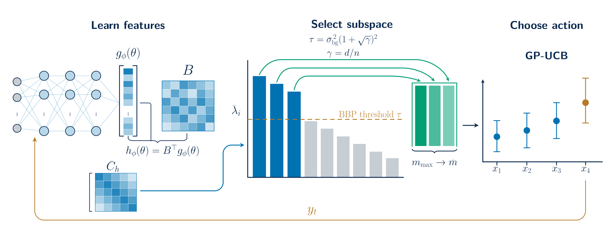

# NN–AGP

Code for *Beyond Dimensions: Spectral Compression for Neural–GP Bandits*.

We compress the GP decision space using fixed relative or adaptive BBP
cutoffs while the full encoder continues training. The selected subspace
also supports physical compression of the network output layer.



## Installation

Python 3.11.

```sh
python -m pip install -r requirements-paper.txt
```

## Paper experiments

Each experiment's settings are in
`paper_experiments/<environment>/EXPxxx/protocol.json`.

List experiments and run one:

```sh
python run_paper.py --list
python run_paper.py --experiment EXP248 --method BBP --seed 6100
```

New runs are saved under `paper_experiments/reruns/`.

Build the paper's tables and figures from saved results:

```sh
python plot_paper.py
```

This writes to `paper_experiments/paper/`.

Run all experiments and build their tables and figures:

```sh
python run_paper.py --all
python plot_paper.py --runs paper_experiments/reruns
```

After all runs finish, the second command writes their tables and figures
to `paper_experiments/paper_rerun/`.

Settings, results, figures and the Excel summary are in
[paper_experiments](paper_experiments/README.md).

Model implementations are in `bandits/`. Environment generators are in
`paper_envs.py`: `WeakBalancedEnv` for Weak and Balanced, `smooth_env` for
Smooth, `kuairec_env` for KuaiRec, and `make_env` with `step` for Exp. 1–10.
The separate BBP experiment is in `paper_bbp.py`.
